

<picture>
  <source media="(prefers-color-scheme: dark)" srcset="assets/header-dark.svg">
  
</picture>


<a href="https://neramc.vercel.app">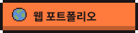</a>
<a href="#inventory">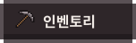</a>
<a href="#workshop">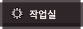</a>

<picture>
  <source media="(prefers-color-scheme: dark)" srcset="assets/shaft/entrance-dark.svg">
  
</picture>

<picture>
  <source media="(prefers-color-scheme: dark)" srcset="assets/shaft/1-about-dark.svg">
  
</picture>

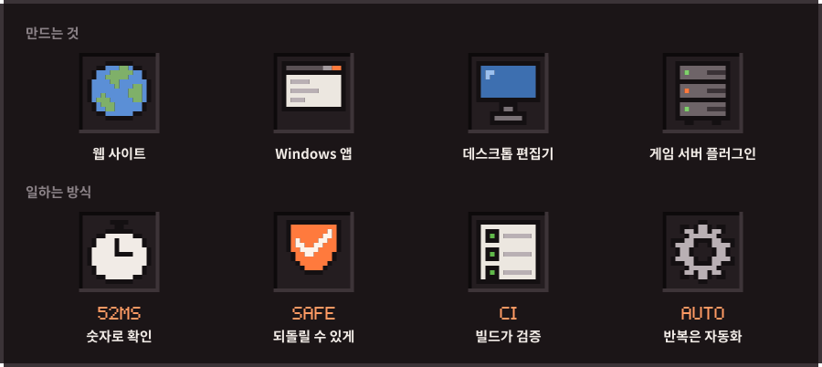

<picture>
  <source media="(prefers-color-scheme: dark)" srcset="assets/shaft/2-inventory-dark.svg">
  
</picture>

<a href="https://github.com/neramc/linuxhub"></a>
<a href="https://github.com/neramc/app-deleter"></a>

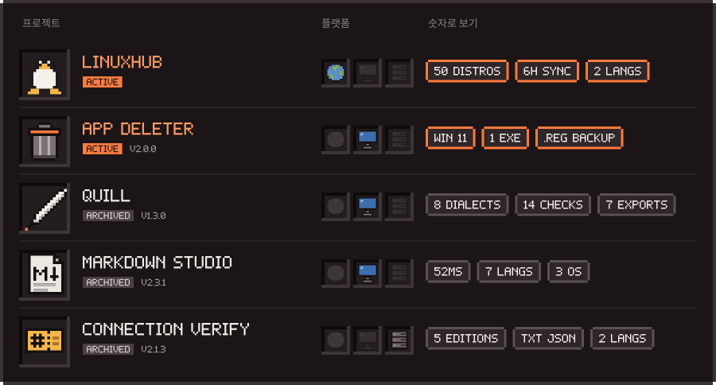

<picture>
  <source media="(prefers-color-scheme: dark)" srcset="assets/shaft/3-gear-dark.svg">
  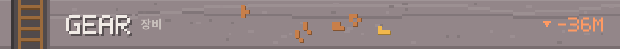
</picture>

<picture>
  <source media="(prefers-color-scheme: dark)" srcset="assets/shaft/4-workshop-dark.svg">
  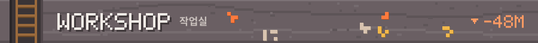
</picture>


<picture>
  <source media="(prefers-color-scheme: dark)" srcset="assets/shaft/5-logs-dark.svg">
  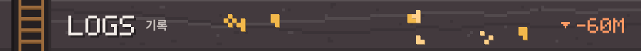
</picture>

<picture>
  <source media="(prefers-color-scheme: dark)" srcset="https://raw.githubusercontent.com/neramc/neramc/output/github-snake-dark.svg">
  
</picture>

