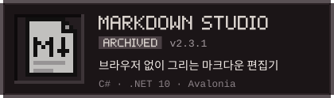
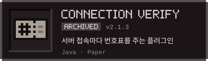

<picture>
  <source media="(prefers-color-scheme: dark)" srcset="assets/header-dark.svg">
  
</picture>

**웹과 데스크톱 앱을 만듭니다.** 
I build web apps and native desktop tools.

## 인벤토리

카드를 누르면 저장소로 이동합니다.

### 장착 중 Active

### 보관함 Archived · 읽기 전용

## 장비 Tech stack

 

 

## 숙련도 Top languages

<picture>
  <source media="(prefers-color-scheme: dark)" srcset="https://github-readme-stats.vercel.app/api/top-langs/?username=neramc&layout=compact&bg_color=141012&title_color=ff9a63&text_color=d8d1cc&border_radius=0&hide_border=true&disable_animations=true">
  
</picture>

## 기여 기록 Contributions

<picture>
  <source media="(prefers-color-scheme: dark)" srcset="https://raw.githubusercontent.com/neramc/neramc/output/github-snake-dark.svg">
  
</picture>

  

