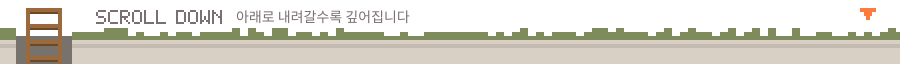
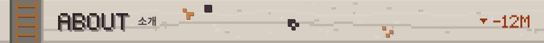
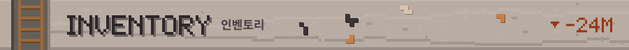
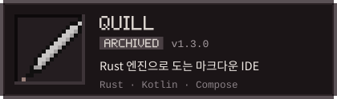
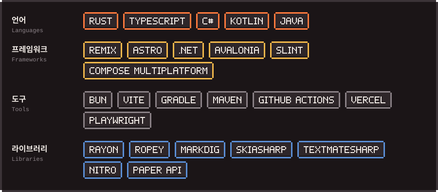
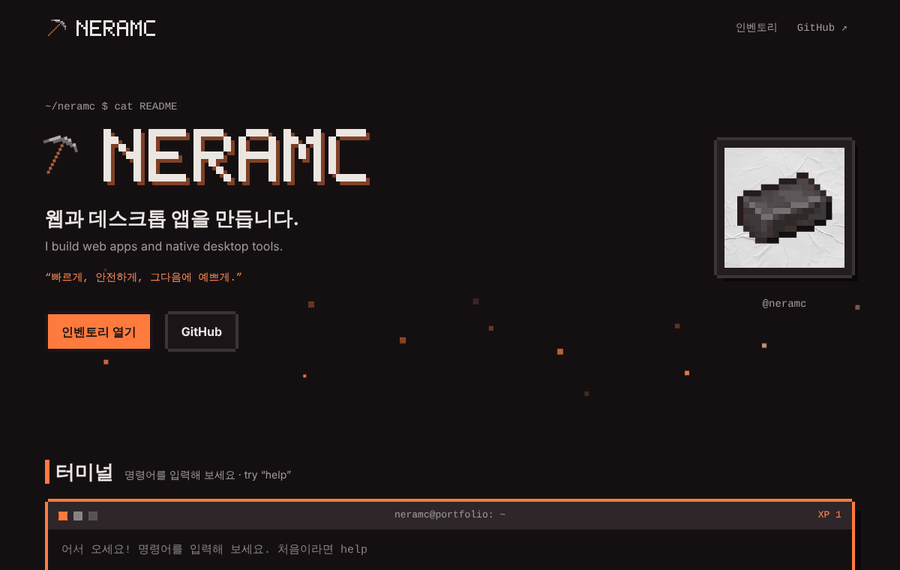

<picture>
  <source media="(prefers-color-scheme: dark)" srcset="assets/header-dark.svg">
  
</picture>

**웹과 데스크톱 앱을 만듭니다.** 
I build web apps and native desktop tools.

[웹 포트폴리오](https://neramc.vercel.app) · [인벤토리](#inventory) · [작업실](#workshop)

<picture>
  <source media="(prefers-color-scheme: dark)" srcset="assets/shaft/entrance-dark.svg">
  
</picture>

<picture>
  <source media="(prefers-color-scheme: dark)" srcset="assets/shaft/1-about-dark.svg">
  
</picture>

안녕하세요, **neramc**입니다. 브라우저에서 도는 사이트부터 Windows 유틸리티, 세 운영체제에서 도는 마크다운 편집기, 마인크래프트 서버 플러그인까지 만들어 왔습니다. 공개 저장소에는 Rust, TypeScript, C#, Kotlin, Java로 만든 프로젝트가 있습니다. 
Hi, I'm neramc. I build things across the stack — websites, Windows utilities, cross-platform editors and Minecraft server plugins.

언어와 플랫폼은 프로젝트마다 달라도, 일하는 방식은 비슷합니다.

- **숫자로 확인합니다.** 빠르다고 말하는 대신 잽니다. Markdown Studio는 10MB 문서에서 키 입력 한 번에 52ms, 1MB에서 4.4ms라는 측정값과 아직 남은 병목을 문서로 남겼습니다.
- **되돌릴 수 있게 만듭니다.** 지우는 도구일수록 조심합니다. App Deleter는 시스템 폴더 보호 가드, 신뢰도 표시, 레지스트리 `.reg` 백업, 휴지통 이동, 복원 지점을 거친 뒤에야 지웁니다. Quill도 되돌릴 수 없는 작업은 조용히 하지 않습니다.
- **규칙은 빌드가 지키게 합니다.** Markdown Studio는 계층 간 참조 방향을 아키텍처 테스트로, CommonMark 스펙 적합성을 CI로 확인합니다. Quill은 README 스크린샷까지 실제 배포 바이너리를 가상 디스플레이에서 실행해 찍었습니다.
- **반복 작업은 자동화합니다.** Linuxhub의 배포판 데이터는 GitHub Actions가 6시간마다 갱신하고, Connection Verify는 CI가 버전을 올려 두 가지 빌드를 함께 릴리스합니다. App Deleter는 태그를 푸시하면 실행 파일과 SHA-256이 릴리스에 올라갑니다.

<picture>
  <source media="(prefers-color-scheme: dark)" srcset="assets/shaft/2-inventory-dark.svg">
  
</picture>

**장착 중** Active · 카드를 누르면 저장소로 이동합니다

<b>Linuxhub</b> — 리눅스 배포판을 둘러보고, 내려받고, 설치까지

 

리눅스 배포판을 둘러보고, 공식 미러에서 내려받고, 설치까지 따라 할 수 있는 카탈로그 사이트입니다. GNOME libadwaita 느낌의 Astro 정적 사이트로, 한국어와 영어를 모두 지원합니다.

- 인기 배포판 약 50개의 공식 로고, 개요, 단계별 설치 가이드
- 공식 미러·CDN 다운로드와 접속 위치 기준 가까운 미러 추천
- GitHub Actions가 6시간마다 릴리스 데이터를 갱신
- 리눅스 가이드, 배포판 찾기, 비교, 계보도, 릴리스 소식
- 린트·타입 검사·단위 테스트·E2E 테스트를 품질 관문으로 사용

`Astro 7` `TypeScript` `Bun` `Vercel` `Playwright` · [저장소](https://github.com/neramc/linuxhub)

<b>App Deleter</b> — 찌꺼기까지 지우는 Windows 11 앱 삭제기

 

앱의 제거 프로그램을 실행한 뒤 남은 파일·폴더·레지스트리·바로가기·서비스·예약 작업·시작 프로그램·방화벽 규칙까지 찾아 정리합니다. "완벽하게" 지우는 것만큼 엉뚱한 것을 지우지 않는 것을 중요하게 설계했습니다.

- 레지스트리 Uninstall 키와 Microsoft Store 앱까지 목록화, 설치 폴더 실측 크기순 정렬
- rayon 병렬 순회와 배치 파일 조회로 폴더 크기를 빠르게 계산
- Job Object로 제거 프로그램의 모든 자식 프로세스가 끝날 때까지 추적
- 시스템 폴더 보호 가드, 신뢰도 표시, `.reg` 백업, 휴지통 이동, 복원 지점
- Windows 11 Fluent 디자인, 라이트/다크 모드, 설치가 필요 없는 단일 실행 파일

`Rust` `Slint` `Win32` `GitHub Actions` · [저장소](https://github.com/neramc/app-deleter) · [v2.0.0 릴리스](https://github.com/neramc/app-deleter/releases/tag/v2.0.0)

**보관함** Archived · 읽기 전용이지만 코드와 릴리스는 그대로 볼 수 있습니다

<b>Quill</b> — Rust 엔진으로 도는 마크다운 IDE

 

마크다운 문서를 개발 환경이 소스 코드를 다루듯 다루는 편집기입니다. 파싱부터 내보내기까지 전부 Rust 엔진이 맡고, Kotlin UI가 Java FFM API로 그 엔진을 호출합니다.

- 하이라이트·개요·통계·검사·미리보기가 모두 같은 파싱 결과에서 나옴
- CommonMark, GFM, MDX, Markdoc, MyST, Pandoc 등 8개 방언
- 입력할 때마다 도는 14개 검사와 Problems 도구 창
- HTML·PDF·Word·EPUB·Confluence·Notion·GitHub README 내보내기
- Vim 모드, Focus Mode, 다섯 가지 범위의 프로젝트 검색

`Rust` `Kotlin` `Compose Multiplatform` `Java FFM` `C#` `Gradle` · [저장소](https://github.com/neramc/quill) · [v1.3.0 릴리스](https://github.com/neramc/quill/releases/tag/v1.3.0)

<b>Markdown Studio</b> — 브라우저 없이 그리는 마크다운 편집기

 

C#과 .NET 10, Avalonia로 만든 마크다운 편집기입니다. 미리보기를 내장 브라우저 없이 네이티브 컨트롤로 직접 그려서, 배포본에 Chromium이 없고 세 운영체제에서 같은 결과를 그립니다.

- 10MB 문서에서 키 입력 한 번에 52ms, 1MB에서 4.4ms
- CommonMark 0.31.2 스펙 스위트를 CI에서 실행
- Windows·macOS·Linux 배포본, 7개 언어 인터페이스
- TextMate 문법 강조, 다중 커서, Vim 키 바인딩
- 계층 간 참조 방향을 아키텍처 테스트로 강제

`C#` `.NET 10` `Avalonia` `Markdig` `SkiaSharp` · [저장소](https://github.com/neramc/markdown-old) · [v2.3.1 릴리스](https://github.com/neramc/markdown-old/releases/tag/v2.3.1)

<b>Connection Verify</b> — 서버 접속마다 번호표를 주는 플러그인

 

마인크래프트 서버의 접속마다 짧은 번호를 붙이고, 번호를 입력하면 그 접속의 상세 리포트를 파일로 저장해 주는 Paper 플러그인입니다. 데이터베이스도 웹 서버도 없이, 콘솔의 번호 하나와 필요할 때 만드는 텍스트(또는 JSON) 파일이 전부입니다.

- 성공한 접속뿐 아니라 밴·화이트리스트·서버 가득 참·끊긴 접속에도 번호 부여
- Log4j2 감시로 이벤트가 없는 이른 연결 끊김까지 포착
- Paper·Purpur·Folia 지원, Velocity·BungeeCord·Fabric·NeoForge 에디션
- IP 마스킹 등 개인정보 옵션과 한국어/영어 메시지
- 변경 파일 수에 따라 CI가 버전을 자동으로 올림

`Java` `Maven` `Paper API` · [저장소](https://github.com/neramc/connection-verify) · [v2.1.3 릴리스](https://github.com/neramc/connection-verify/releases/tag/v2.1.3)

<picture>
  <source media="(prefers-color-scheme: dark)" srcset="assets/shaft/3-gear-dark.svg">
  
</picture>

프로젝트 안에서 쓴 라이브러리: rayon · ropey · Markdig · SkiaSharp · TextMateSharp · Nitro · Paper API

<picture>
  <source media="(prefers-color-scheme: dark)" srcset="assets/shaft/4-workshop-dark.svg">
  
</picture>

**[neramc.vercel.app](https://neramc.vercel.app)** — 이 README와 같은 픽셀아트 테마로 만든 웹 포트폴리오입니다. 터미널에 `help`, `ls`, `open quill`, `mine`을 직접 입력해 보세요.

이 프로필과 사이트는 이렇게 만들었습니다.

- **그림은 전부 코드로 그렸습니다.** 헤더, 터미널, 카드, 지층 띠, 장비 패널은 [`scripts/build_assets.py`](scripts/build_assets.py)가 외부 이미지 없이 만든 SVG입니다. 같은 픽셀 글꼴·아이콘 데이터가 웹사이트에도 그대로 쓰입니다.
- **웹 포트폴리오는 [Remix 3](https://remix.run)로 서버에서 그립니다.** 브라우저에서 하이드레이트되는 건 터미널 하나뿐이고, 자바스크립트가 꺼져 있어도 같은 명령어를 서버가 처리합니다. Vite로 빌드하고 Nitro로 Vercel에 배포합니다. → [`portfolio/`](portfolio)
- **기여 그래프 뱀은 매일 새로 그려집니다.** GitHub Actions가 기여 기록으로 애니메이션을 만들어 `output` 브랜치에 올립니다. → [`snake.yml`](.github/workflows/snake.yml)

<picture>
  <source media="(prefers-color-scheme: dark)" srcset="assets/shaft/5-logs-dark.svg">
  
</picture>

<picture>
  <source media="(prefers-color-scheme: dark)" srcset="https://github-readme-stats.vercel.app/api/top-langs/?username=neramc&layout=compact&bg_color=141012&title_color=ff9a63&text_color=d8d1cc&border_radius=0&hide_border=true&disable_animations=true">
  
</picture>

<picture>
  <source media="(prefers-color-scheme: dark)" srcset="https://raw.githubusercontent.com/neramc/neramc/output/github-snake-dark.svg">
  
</picture>

